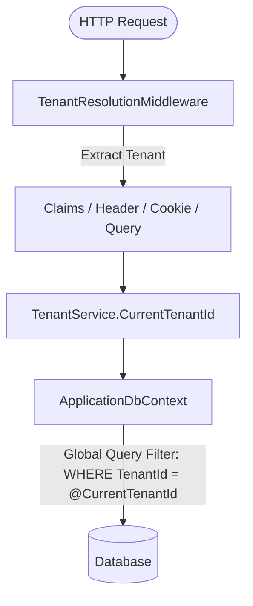

# ExamNexus &mdash; System Architecture & Technical Specification

## Table of Contents
1. [Introduction & Business Problem](#1-introduction--business-problem)
2. [Technology Stack](#2-technology-stack)
3. [Clean Architecture & Project Structure](#3-clean-architecture--project-structure)
4. [Multi-Tenancy Engineering](#4-multi-tenancy-engineering)
5. [Real-Time SignalR Anti-Cheat Engine](#5-real-time-signalr-anti-cheat-engine)
6. [Exam Lifecycle & Auto-Grading Engine](#6-exam-lifecycle--auto-grading-engine)
7. [Database Schema & Stored Procedures](#7-database-schema--stored-procedures)
8. [Security & Authentication Flow](#8-security--authentication-flow)
9. [Running & Testing Guide](#9-running--testing-guide)

---

## 1. Introduction & Business Problem
ExamNexus was engineered to solve three major challenges in cloud-based education platforms:
- **Tenant Isolation**: Different schools, universities, and enterprise certification providers need independent environments without cross-tenant data leaks.
- **Academic Integrity**: Remote assessments suffer from browser tab switching, external aid lookups, and ghost sessions.
- **Resilient Exam Taking**: Candidates experiencing network latency must have answers saved automatically without losing their ongoing attempts.

---

## 2. Technology Stack
- **Framework**: .NET 9.0 (`net9.0`) & C# 13.
- **Data Access**: Entity Framework Core 9.0.2 with Global Query Filters.
- **Real-Time Communication**: ASP.NET Core SignalR (WebSockets).
- **Authentication**: ASP.NET Core Identity with custom Application Cookie & JWT Bearer token generation.
- **Frontend**: Razor Pages / MVC, Bootstrap 5.3, Font Awesome 6.5, JetBrains Mono & Plus Jakarta Sans typography.
- **Storage**: Multi-Tenant Schema SQL Server (`ExamNexus SaaS DB.sql`) & SQLite for zero-friction local development.

---

## 3. Clean Architecture & Project Structure

The codebase is organized into four decoupled layers:

### A. ExamNexus.Domain
Contains purely domain models, domain rules, and entity invariants with zero external dependencies:
- `BaseEntity`, `BaseTenantEntity`, `ITenantEntity`
- `Tenant`, `ApplicationUser`, `RefreshToken`
- `Course`, `QuestionBank`, `Question`, `QuestionOption`
- `Exam`, `ExamQuestion`
- `CandidateExamSession`, `CandidateAnswer`, `ProctorEvent`, `AuditLog`

### B. ExamNexus.Application
Encapsulates business contracts, service abstractions, and data transfer objects:
- `ITenantService`: Tenant identification contract.
- `ICurrentUserService`: Authenticated identity context.
- `IProctorHubClient`: SignalR strongly-typed client dispatch contract.
- `IApplicationDbContext`: Repository interface for unit-of-work persistence.
- `IJwtTokenService`: Cryptographic JWT signing and refresh token rotation contract.
- DTOs for authentication, lobby listings, live session state, and proctor telemetry.

### C. ExamNexus.Infrastructure
Implements persistence, database migrations, security, and tenant filters:
- `ApplicationDbContext`: Configured with schema `ExamSaaS` and EF Core Global Query Filters (`_tenantService.CurrentTenantId == null || e.TenantId == _tenantService.CurrentTenantId`).
- `TenantService`: Multi-stage fallback tenant resolution (Claims -> Header -> Cookie -> Query).
- `JwtTokenService`: Signs HMAC-SHA256 tokens and validates refresh tokens.
- `DbInitializer`: Automatic database migration and mock seed data.

### D. ExamNexus.Web
The entry point delivering UI and API services:
- Controllers:
  - `AccountController`: Multi-tenant login, cookie issuance, and 1-click test credentials.
  - `DashboardController`: Tenant analytics, exam catalogs, and candidate attempt history.
  - `ExamController`: Lobby, passcode authorization, live timed session, AJAX autosave, and submission grading.
  - `ProctorController`: WebSocket command center with active candidate stream and live telemetry.
  - `Api/AuthController`: Headless REST API endpoints for JWT issuance.
- `Hubs/ProctorHub`: SignalR Hub orchestrating real-time student-to-proctor communication.

---

## 4. Multi-Tenancy Engineering

ExamNexus implements a **Discriminator-Column Partitioned Multi-Tenancy Model**:



### Automatic Tenant Injection
When saving changes in EF Core, `ApplicationDbContext.SaveChangesAsync` intercepts entity state:
```csharp
var tenantId = _tenantService.CurrentTenantId;
if (tenantId.HasValue && tenantId.Value != Guid.Empty)
{
    foreach (var entry in ChangeTracker.Entries<ITenantEntity>().Where(e => e.State == EntityState.Added))
    {
        if (entry.Entity.TenantId == Guid.Empty)
        {
            entry.Entity.TenantId = tenantId.Value;
        }
    }
}
```

---

## 5. Real-Time SignalR Anti-Cheat Engine

The platform coordinates real-time monitoring via `ProctorHub`:

1. **Candidate Connection**:
   - Upon launching an exam, candidate script calls `JoinExamSession(sessionId)`.
   - The candidate is joined to group `session_{sessionId}` and proctor group `proctor_tenant_{tenantId}`.

2. **Tab Switch Tracking**:
   - `document.visibilitychange` and `window.blur` fire whenever the candidate leaves the exam tab.
   - The client invokes `ReportTabSwitch(sessionId)`.
   - The hub persists a `ProctorEvent` with severity `Warning` or `Critical`.
   - The hub triggers `CandidateViolationAlert` on all connected proctors in the organization.

3. **Remote Intervention**:
   - Proctors can call `SendProctorWarningToCandidate(sessionId, message)`.
   - Proctors can remotely terminate sessions via `TerminateSession`, locking the student screen immediately.

---

## 6. Exam Lifecycle & Auto-Grading Engine

```
[Lobby] -> [Passcode Entry] -> [Live Session] -> [AJAX Autosave] -> [Submit] -> [Auto-Grade] -> [Result]
```

### Auto-Grading Algorithm
Upon submission (`ExamController.Submit`):
1. Evaluates all selected options against `QuestionOptions.IsCorrect`.
2. Awards configured question points or 0.
3. Computes `TotalScore = SUM(AwardedMarks)`.
4. Calculates `Percentage = (TotalScore / TotalMarks) * 100`.
5. Compares against `PassingScorePercent` to set `HasPassed = true | false`.
6. Checks if `TabSwitchCount > MaxTabSwitchesAllowed`; if true, flags the attempt with audit reason.

---

## 7. Database Schema & Stored Procedures

The database file resides at `D:\Anubhaw\Projects\DB\ExamNexus SaaS DB.sql` under schema `ExamSaaS`:
- Tables: `Tenants`, `Courses`, `QuestionBanks`, `Questions`, `QuestionOptions`, `Exams`, `ExamQuestions`, `CandidateExamSessions`, `CandidateAnswers`, `ProctorEvents`, `AuditLogs`, `AspNetUsers`, `AspNetRoles`, `AspNetUserRoles`, `RefreshTokens`.
- Stored Procedures:
  - `sp_StartCandidateExamSession`: Starts an atomic exam session.
  - `sp_SubmitCandidateExamSession`: Evaluates score and seals session.
  - `sp_LogProctorEvent`: Records anti-cheat audit occurrences.
  - `sp_GetTenantProctorDashboardSummary`: Aggregates active candidate statistics.
